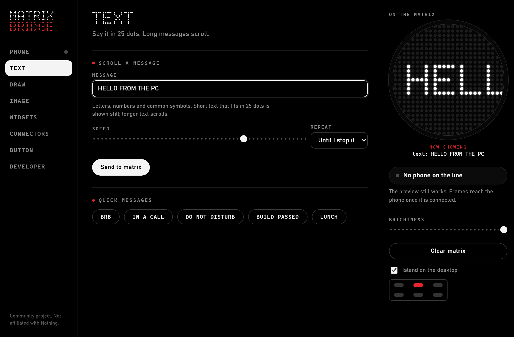
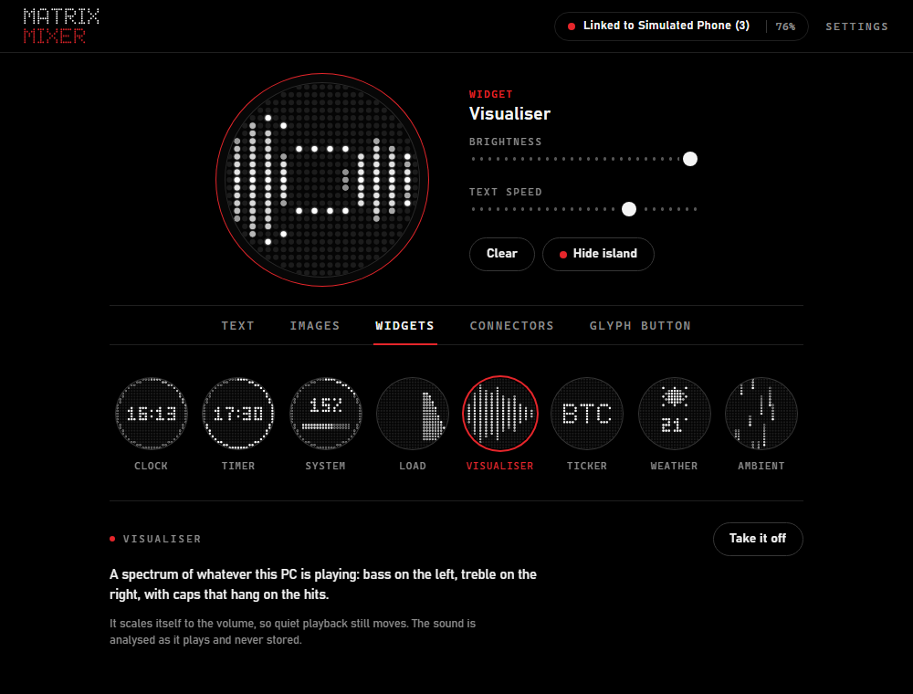
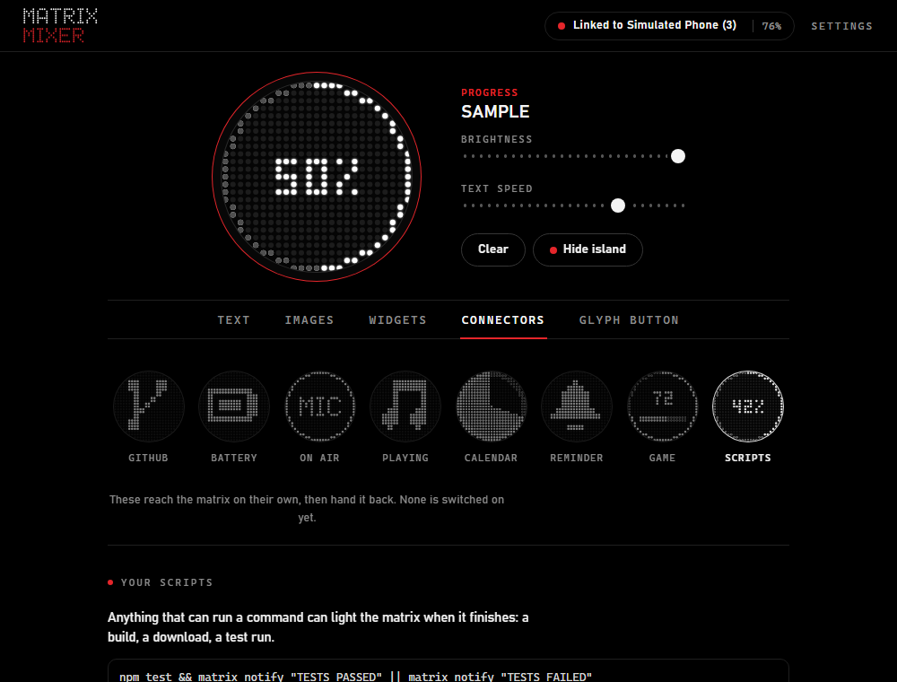
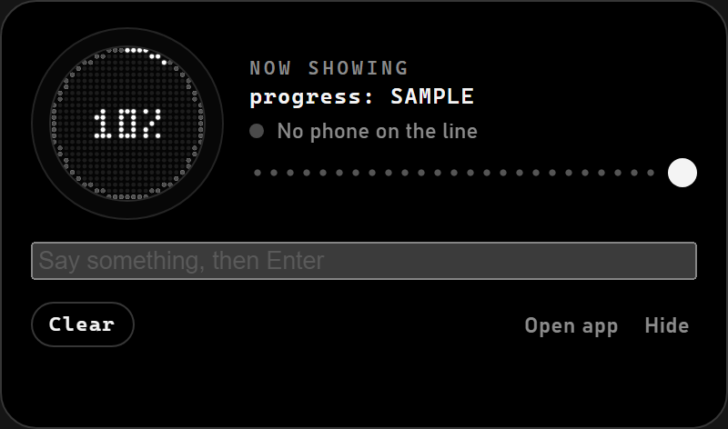

# MatrixMixer

**Your Nothing phone's Glyph Matrix, powered by your PC.**

MatrixMixer turns the Glyph Matrix on the back of a Nothing phone into a status light for your desk. Your PC decides what it shows: a message, a build's progress, the song you are playing, a red ring while you are on a call. The Glyph Button becomes an extra key for your PC.

Open source, community-built, and not affiliated with or endorsed by Nothing.



> **Status: early.** Tested on a real Phone (3) over USB, and against a simulated phone. Several newer features have only been tried on one PC. Expect rough edges and please [report them](../../issues).

## What it does

**Show things on the matrix**
- Scrolling text, a pixel editor, and images or GIFs shrunk to the round matrix
- Widgets: clock, Pomodoro and countdown, CPU/RAM meter, load graph, stocks and crypto ticker, weather
- A music visualiser: a 12-band spectrum of whatever your PC is playing, with peak caps that hang on the hits



**Let things reach the matrix on their own**
- A progress ring for long jobs: `matrix progress 42 BUILD`, then DONE when it reaches 100
- On air: the ring breathes while an app uses your microphone or camera
- Now playing: the title and artist pass by when a new track starts
- Calendar: a heads-up before each meeting, from a private .ics link
- GitHub pushes and CI results, PC battery low or full, and anything your own scripts send
- A game HUD for Counter-Strike 2: health on the ring, ammo on a bar

Notices pass once, then hand the matrix back to whatever was showing.



**The island**

A small always-on-top pill on your PC desktop mirrors the matrix. Hover it for brightness, a quick message box, Clear, and a shelf of widgets with live readings. Put it in any of six spots, or switch it off.



**Use the phone as a PC button**
- Long-press the Glyph Button to play/pause media, mute, lock the PC or run any command

**For developers**
- A `matrix` command line tool and a local HTTP API, so any script can push to the matrix

```
npm test && matrix send "tests passed" || matrix send "TESTS FAILED"
```

**Not in scope:** notifications, SMS and calls (use Phone Link), files and clipboard (KDE Connect), screen mirroring (scrcpy). Those tools already do it well.

## How it works

```
 PC                                              Nothing phone
 ┌──────────────────────────────┐   Wi-Fi/USB   ┌─────────────────────────┐
 │ text / image / widget        │   WebSocket   │ foreground service      │
 │   -> matrix frame (TypeScript)│ ────────────> │   -> Glyph Matrix SDK   │
 │ action runner (Rust)         │ <──────────── │ "PC Remote" Glyph Toy   │
 └──────────────────────────────┘ button events └─────────────────────────┘
```

The PC renders everything into finished frames sized for the phone's matrix. The phone only draws them and reports button presses, which keeps the Android app small. No cloud and no account: PC and phone talk directly over your own network or USB. The only outside services are the optional weather, ticker and calendar features.

| Folder | What | Built with |
|---|---|---|
| `core/` | Protocol, rendering, connection client | TypeScript |
| `desktop/` | PC app | Tauri 2, React, TypeScript |
| `cli/` | `matrix` command and a phone simulator | Node |
| `android/` | Phone app | Kotlin, Nothing's Glyph Matrix SDK |
| `docs/` | [Setup](docs/SETUP.md), [protocol](docs/PROTOCOL.md) | |

## Install

Grab the Windows installer and the APK from [Releases](../../releases), or build from source with [docs/SETUP.md](docs/SETUP.md).

1. Install the APK on the phone, open **MatrixMixer** and tap **Start**.
2. Open MatrixMixer on the PC and press **Search this network**.
3. Type the 6-digit code shown on the phone.
4. Send something from the **Text** tab.

Built for every Nothing phone with a Glyph Matrix:

| Phone | Matrix | Support |
|---|---|---|
| Phone (3) | 25x25 | Works, tested on real hardware (Nothing OS from August 2025 or later) |
| Phone (4a) Pro | 13x13 | Planned: frames are drawn at 25x25 for now |

Own a Glyph Matrix phone that is not on this list? [Open an issue](../../issues) and help add it.

**College or hostel Wi-Fi?** Those networks usually stop devices seeing each other. Plug the phone in, run `adb forward tcp:8765 tcp:8765`, and use **Connect over USB**. A phone hotspot works too.

## Using the Glyph Button

Nothing OS only shares the Glyph Button with the Glyph Toy that is currently selected. Add the **PC Remote** toy in Settings > Glyph Interface > Glyph Toys, then short-press the Glyph Button until its two-headed arrow shows. From then on a long-press triggers the action you picked in the PC app's **Glyph Button** tab. A short press is never delivered to apps; it moves on to the next toy.

## Command line

```
matrix send "build passed"            scroll text
matrix notify "build passed"          blink, pass once, then give the matrix back
matrix progress 42 BUILD              fill the ring as a job runs; "done" finishes it
matrix image logo.png --invert        show a PNG or JPEG
matrix brightness 120
matrix clear
matrix sim                            run a fake phone in the terminal
```

While the PC app is running, commands go through it. The HTTP API behind it is documented in the app's **Developer** tab.

## Security

- The phone accepts frames only from PCs that have paired with a code read off its screen. A code works once; five wrong guesses lock pairing for 30 seconds.
- Traffic is unencrypted and meant for a network you trust. Anyone on the same network can see the frames (not much of a secret: it is 625 brightness values).
- The PC's local API listens on `127.0.0.1` only, needs a token that changes every launch, and refuses requests from web pages.
- "Run a command" actions run exactly what you typed, as you. Only you can set them, from the PC app.
- The visualiser analyses your PC's sound as it plays and never stores it. The weather, ticker and calendar features contact Open-Meteo, Yahoo Finance and your calendar provider; nothing else leaves your network.

## Contributing

See [CONTRIBUTING.md](CONTRIBUTING.md). You do not need a Nothing phone to work on the PC side: `npm run sim` gives you a fake one.

## Licence and credits

MIT, see [LICENSE](LICENSE). Nothing's Glyph Matrix SDK is not part of this repository; it is downloaded at build time under [Nothing's own licence](https://github.com/Nothing-Developer-Programme/GlyphMatrix-Developer-Kit/blob/main/LICENSE.md), which restricts commercial use.

Nothing, Phone (3), Phone (4a) Pro, Glyph and Glyph Matrix are trademarks of Nothing Technology Limited. This project is not affiliated with Nothing.
